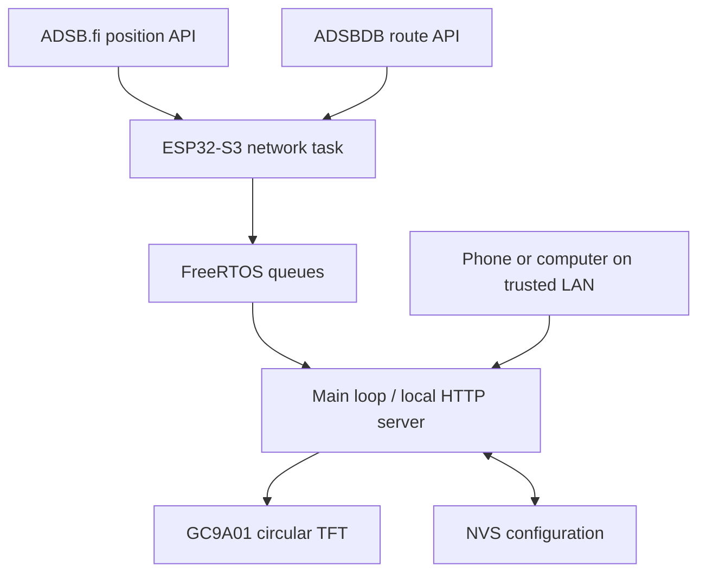

# XWiz Flight Tracker

A standalone Wi-Fi aircraft radar and local IoT control panel built using an ESP32-S3 and a 1.28-inch circular TFT. A hobby project exploring embedded C++, web controls, public aircraft data APIs, graphics, configuration persistence and iterative hardware design.

**Current status:** V0.8.1 firmware passed 10/10 owner-reported functional acceptance tests on November 24, 2026. V0.9 enclosure fit gauges are in testing. Final enclosure, security hardening and extended reliability testing are pending.

## Features

- North-up radar with animated sweep, directional aircraft markers and up to 100 plotted aircraft.
- Adjustable 10/25/50/100 nautical mile radius (default 50 NM).
- Blue, green, amber and red display themes; blue by default.
- Aircraft callsign, operator where available, registration, type, altitude, ground speed and vertical movement.
- Database-derived departure/destination airports when available, with cached route lookups.
- Closest fresh airborne aircraft, bearing and ground track, automatic spotter mode and optional visual 5 NM alert.
- Local password-protected HTTP settings panel with persistent NVS storage.
- Background HTTP requests, filtered JSON parsing using PSRAM when available, and framebuffer rendering.

## Architecture

## Hardware and setup

| Part | Specification |
|---|---|
| Microcontroller | ESP32-S3 N16R8 development board, 16 MB flash / 8 MB PSRAM |
| Display | GC9A01 1.28-inch, 240 × 240 SPI TFT, 7-pin module |
| Power | USB-C to ESP32; display supplied from 3.3 V |
| Enclosure | V0.9 fit gauges, full case pending |

See [wiring and setup](hardware/wiring.md), [parts list](hardware/parts-list.md), and [firmware installation](firmware/V0.8.1/README.md). The exact tested firmware is **not included in this starter package**: copy your saved, working V0.8.1 sketch after removing real credentials. Do not present this repository as a complete firmware release until that source is added.

## Control panel

On the trusted local Wi-Fi network, open `http://<device-ip>` using the IP printed in Serial Monitor (115200 baud) or periodically shown on the radar. Log in with the configured `admin` username and custom web password. Set radius, theme, proximity alerts and route lookups; save and restart to verify persistence.

## Development and results

See the [changelog](CHANGELOG.md), [troubleshooting notes](testing/troubleshooting.md), [acceptance tests](testing/acceptance-v0.8.1.md), and [enclosure notes](enclosure/README.md). Photos can be added under `images/` after reviewing for private details.

## Limitations and security

- Radar is centered at a manually configured approximate location; Wi-Fi does not locate the device. Distances are horizontal, not slant range.
- Aircraft reports can be missing, delayed or stale. Routes are callsign database matches, not verified live itineraries. A proximity alert is a hobby display, not collision avoidance or navigation.
- The web panel uses HTTP; credentials are not encrypted in transit. Outbound HTTPS certificate verification is disabled in the prototype. Use a trusted LAN only; do not port-forward the device.
- Data source availability and rate limits affect refreshes. Functional acceptance testing is not proof of continuous uptime.
- This project is not affiliated with aviation data providers or hardware manufacturers. Review their data terms before redistribution or commercial use.

## Data sources and libraries

- [ADSB.fi](https://adsb.fi/) — aircraft positions.
- [ADSBDB](https://adsbdb.com/) — callsign route metadata.
- [Arduino-ESP32](https://github.com/espressif/arduino-esp32), [ArduinoJson](https://arduinojson.org/), [Adafruit GFX](https://github.com/adafruit/Adafruit-GFX-Library), [Adafruit GC9A01A](https://github.com/adafruit/Adafruit_GC9A01A), [Adafruit BusIO](https://github.com/adafruit/Adafruit_BusIO).

## Roadmap

V0.9: validate fit gauges, design and print housing. V1.0: physical assembly, extended reliability testing and certificate validation. Future: live browser radar, homelab flight history and optional Telegram integration.

## License

No license selected yet. Review [licensing notes](LICENSE-NOTES.md) before publishing. Third-party software and data remain subject to their own terms.
